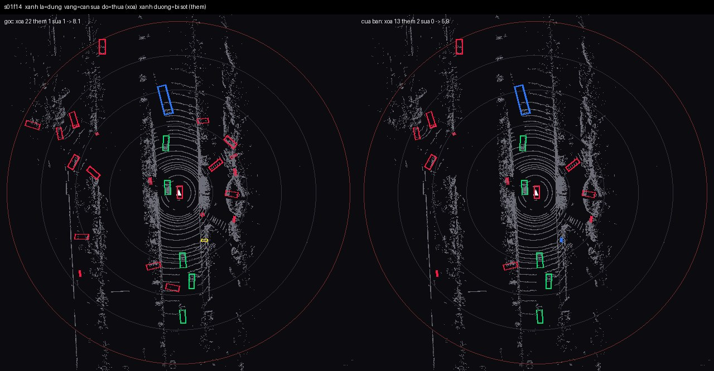

# Báo cáo Day 14 — Nguyễn Thế Tùng — 2A202603320

- Mã học viên dùng với `--student`: `2A202603320`
- `seed_tag` trong `frames_A.txt`: `82ac3100fd`

## 1. Dự đoán trước sweep (bước 5b)

- Tham số tôi nghĩ giảm công sửa nhiều nhất: **`score_thr=0.4`, `min_points=10`**.
- Vì sao (nhìn ảnh BEV tập A: box thừa nhiều hay box sót nhiều?): Ảnh BEV và ảnh camera cho thấy **box thừa nhiều hơn box sót rõ rệt**. Phần lớn box thừa nằm trong dải cây/bụi rậm và quanh biển báo, nhiều box vẫn có `score` cao (0.3–0.5) nên chỉ nâng ngưỡng lên 0.2–0.3 sẽ không cắt được. Tôi dự đoán nâng `score_thr` lên **0.4** sẽ loại phần lớn nhóm này, còn `min_points=10` bỏ thêm các box chỉ có vài điểm LiDAR ở xa. Tôi không chọn `score_thr=0.5` vì bắt đầu sót xe thật; mỗi box sót tốn 1.0 điểm, trong khi xóa box thừa chỉ tốn 0.3 điểm. Với nhãn tham chiếu vừa sửa, cấu hình gốc đang có 34 box thừa, 6 box sót và 2 box cần sửa (chi phí 17.2), nên ưu tiên cắt box thừa là hợp lý.

## 2. Tập A: sửa tay và tune

| Cấu hình | Xóa | Thêm | Sửa | Chi phí |
|---|---:|---:|---:|---:|
| Gốc | 36 | 6 | 2 | 17.8 |
| `best_config.json` | 19 | 8 | 1 | 14.2 |

- Tham số đã đổi trong `best_config.json`: `score_thr: 0.1 -> 0.4`; `min_points: 0 -> 10`.
- Kết quả leave-one-out (dán các dòng `scripts/pp_sweep.py` in ra):

```text
  s01f14: cấu hình chọn {'score_thr': '0.4', 'min_points': '10'} → 5.9 (tốt nhất có thể 4.1)
  s04f02: cấu hình chọn {'score_thr': '0.5', 'min_points': '10'} → 5.3 (tốt nhất có thể 4.8)
  s05f13: cấu hình chọn {'score_thr': '0.5', 'min_points': '10'} → 4.9 (tốt nhất có thể 3.4)
```

- Cấu hình có ổn định trên từng frame không? Vì sao tôi vẫn chọn (hoặc không chọn) nó: Không hoàn toàn ổn định: khi bỏ `s04f02` hoặc `s05f13`, cấu hình chọn từ 2 frame còn lại là `0.5/10`. Tuy nhiên `0.5/10` làm tăng box sót từ 8 lên 11 (mỗi cái tốn 1.0) nên tổng chỉ hơn 0.1 (14.3 so với 14.2); trên chính 2 frame đó, `0.4/10` cho 4.8 và 3.5, thấp hơn hoặc bằng mức leave-one-out báo. Với 3 frame tune nên tôi giữ `0.4/10` vì cân bằng xóa/sót hơn. Ngưỡng đã thử ở batch A là `0.5` với `min_points=10`: `Car` sạch hơn (phải xóa 13 → 8) nhưng các lớp nhỏ vẫn yếu — `Pedestrian` sót 6 (so với 5 ở `0.4`), `Bus` sót 1 (bằng nhau), `Truck` sót 1 (trong khi `0.4` chỉ phải sửa 1), bản thân `Car` cũng bắt đầu sót thêm 1 box. Tổng chi phí 14.3, hơn 0.1 so với 14.2 của `0.4/10`, nên tôi không chọn ngưỡng này.

## 3. Trước/sau (bước 8)



- `scripts/pp_compare.py` báo giảm **20%** công sửa trên tập A (17.8 → 14.2). Theo frame: `s01f14` 8.1 → 5.9, `s04f02` 6.3 → 4.8, `s05f13` 3.4 → 3.5.
- Dự đoán ở mục 1 **đúng**: `score_thr=0.4, min_points=10` là cấu hình chi phí thấp nhất trong sweep. Box phải xóa giảm từ 36 xuống 19 (tiết kiệm 5.1), đổi lại box sót tăng từ 6 lên 8 (tốn thêm 2.0) và sửa giảm 2 → 1 (tiết kiệm 0.5); ròng giảm 3.6. `s05f13` tăng nhẹ 0.1 do cắt mất một box thật, nhưng hai frame còn lại giảm nhiều hơn. Ảnh so sánh dùng `s01f14`.

## 4. Tập B

Số đo từ `scripts/pp_prelabel.py --frames d14_2A202603320/frames_B.txt --config d14_2A202603320/best_config.json --gt d14_2A202603320/ref_B.json`:

| Xóa | Thêm | Sửa | Chi phí |
|---:|---:|---:|---:|
| 114 | 13 | 4 | 49.2 |

- Loại box tốn công sửa nhất ở tập B: **Car thừa**. Trong 114 box phải xóa thì 70 là `Car` (21.0 điểm, chiếm ~43% tổng chi phí), 41 là `Cyclist` (12.3 điểm) và 3 là `Pedestrian`. Nhiều box `Car` thừa là xe của chính xe thu dữ liệu (tâm cách LiDAR 0.4–0.6 m, vẫn có 400–500 điểm nên `min_points=10` không cắt được) và xe nằm trong bụi cây/biển báo. Ở chiều ngược lại, nhóm phải thêm có 6 `Car`, 4 `Truck`, 2 `Cyclist`, 1 `Bus` — riêng `Truck`/`Bus` (5 box, 5.0 điểm) là lớp model KITTI không có nên luôn phải thêm tay.

## 5. Giới hạn

- Tập A chỉ có **3 frame** để tune nên dễ overfit. Leave-one-out cho thấy khi bỏ `s04f02` hoặc `s05f13` thì cấu hình chọn từ 2 frame còn lại là `0.5/10`, không phải `0.4/10` đã nộp; cấu hình vì thế chưa chắc ổn định trên dữ liệu mới.
- Model huấn luyện trên **KITTI** (LiDAR 64 tia, chỉ nhìn 90° phía trước, 3 lớp Car/Cyclist/Pedestrian). Dù lab xoay 4 lượt để phủ 360°, model vẫn không biết `Truck`/`Bus` và bỏ sót nhiều `Pedestrian`/`Cyclist` ở xa — đúng như 13 box phải thêm ở tập B.
- Chi phí chỉ là **công thức** `0.3·xóa + 1.0·thêm + 0.5·sửa`, chấm trong phạm vi 50 m và ghép box BEV IoU ≥ 0,3; không phải thời gian sửa thật trên CVAT. Pre-label có tác dụng giảm công, không thay thế người gán nhãn — mọi box nộp đều đã được kiểm tay.
